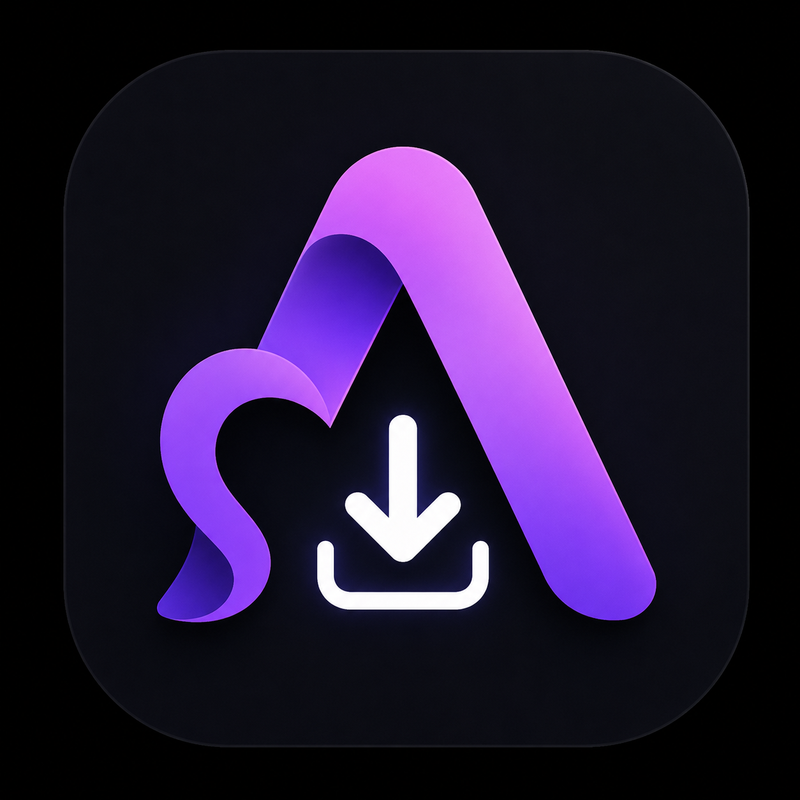
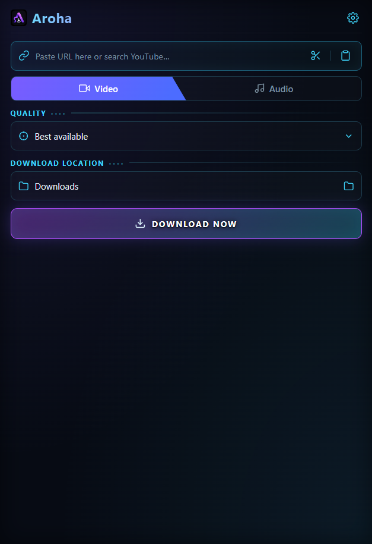
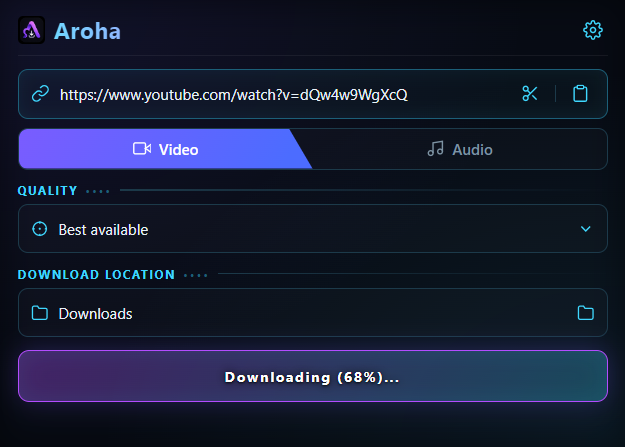
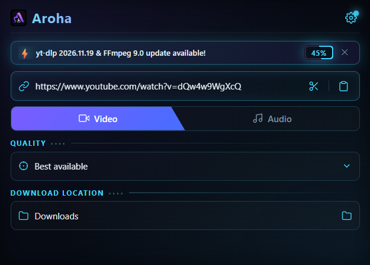

# ⚡ Aroha for Adobe Premiere Pro

<div align="center">



### *The High-Speed Downloader & Direct Timeline Importer Extension for Adobe Premiere Pro*

[](https://www.adobe.com/products/premiere.html)
[](https://github.com/Adobe-CEP)
[](https://github.com/yt-dlp/yt-dlp)
[](https://ffmpeg.org/)
[](LICENSE.txt)

[**Download Installer (.exe)**](#-quick-installation-recommended) • [**Features**](#-features) • [**Screenshots**](#-screenshots) • [**Developer Setup**](#-developer--manual-setup) • [**Architecture**](#-architecture)

</div>

---

## 📖 Overview

**Aroha** is a professional Adobe Premiere Pro CEP extension panel engineered for video editors, content creators, and post-production studios. It allows you to download ultra-high-definition video (4K/8K, 60fps, HDR) and high-fidelity audio from over **1,000+ streaming platforms** (YouTube, TikTok, Instagram Reels, Twitter/X, Vimeo, SoundCloud, and more) and inject them **directly into your active Premiere Pro timeline or project bin** with a single click.

No more switching between browser tabs, converting media files, or dragging items from File Explorer.

---

## 📸 Screenshots

<div align="center">

### 🖥️ Main Extension Panel
*Cyberpunk neon interface with direct resolution selector (8K/4K/1080p/720p), audio options, and 1-click timeline import.*



---

### ⚡ Active Download with Instant Cancel Control
*Real-time fluid progress bar with live speed (MB/s), ETA timer, download size counter, and dedicated red Cancel button that kills processes and unlinks all disk junk.*



---

### 🔔 1-Click Flash Auto-Update Banner
*Non-blocking launch check with slide-down notification bar, settings alert badge, and glowing 4-corner perimeter runner on the Update button.*


---

### 🛠️ In-App Engine Diagnostics & Health Check
*Live component status monitor for yt-dlp nightly, FFmpeg 9.0, hardware acceleration (NVIDIA NVENC / CPU x264), and download location.*



</div>

---

## ✨ Features

- **🎬 Direct Premiere Pro Timeline Import**
  - Uses native Adobe ExtendScript DOM API (`jsx/host.jsx`) to insert downloaded media directly at the current playhead position in the active sequence.
  - Optional secondary action: **"Add to Project"** imports media cleanly into your project bin.
- **🛑 Complete Download Abort & Junk Cleanup**
  - Dedicated **Cancel Download** button stops long or accidental downloads instantly.
  - Executes Windows process tree termination (`taskkill /T /F`) and automatically unlinks partial `.part`, `.ytdl`, `.temp`, and `aroha_raw_*` temp files so your storage stays spotless.
- **🔄 Smart Auto-Update & 4-Corner Progress Runner**
  - Checks for the latest `yt-dlp` nightly and `FFmpeg` updates upon launching the extension without blocking the UI.
  - Shows an eye-catching **4-corner neon perimeter progress runner** around the update button (`0%` to `100%`) while updates stream in real-time.
- **⚡ Hardware-Accelerated Video Transcoding**
  - Integrated GPU hardware encoding support (**NVIDIA NVENC**, Intel QuickSync, AMD AMF) for near-instant format remuxing to Premiere Pro-compatible MP4/AAC.
- **🌐 1000+ Video & Audio Sites Supported**
  - Full support for YouTube (4K, 8K, HDR, 60fps), YouTube Shorts, Instagram Reels, TikTok, Twitter/X, Vimeo, Facebook, Dailymotion, Twitch Clips, SoundCloud, and hundreds more.
- **📦 Zero-Config Standalone Installer**
  - Built with Inno Setup (LZMA2 Ultra Solid Compression).
  - Automatically enables Adobe CEP `PlayerDebugMode` in the Windows registry across all Premiere Pro versions (CSXS 6 through 25).
  - No administrator privileges required.

---

## 🚀 Quick Installation (Recommended)

For end users and editors:

1. Go to the [**Releases**](https://github.com) section and download `Aroha_Premiere_Extension_Installer_v1.0.0.exe`.
2. Run the installer and click **Install**.
3. Open **Adobe Premiere Pro**.
4. In the top menu, go to:
   ```text
   Window > Extensions > Aroha
   ```
5. Dock the Aroha panel anywhere in your workspace!

---

## 🛠️ Developer & Manual Setup

If you want to clone, contribute, or build Aroha from source:

### Prerequisites
- Windows 10 / 11 64-bit
- Adobe Premiere Pro (2020 through 2026)
- Git and PowerShell

### 1. Clone the Repository
```bash
git clone https://github.com/<your-username>/aroha-premiere-extension.git
cd aroha-premiere-extension
```

### 2. Download Bundled Binaries (yt-dlp & FFmpeg)
Because GitHub has a strict 100MB file limit, the 110MB FFmpeg binary is excluded from git. Run the included setup script to download them locally into `bin/win-x64/`:

```powershell
# In PowerShell:
.\setup_binaries.ps1

# Or double-click:
setup_binaries.bat
```

### 3. Link Extension to Adobe CEP Directory
Create a directory symlink or copy the extension folder to your user's Adobe CEP directory:

```powershell
# Target path:
# %APPDATA%\Adobe\CEP\extensions\com.aroha.premiere.extension

New-Item -ItemType SymbolicLink -Path "$env:APPDATA\Adobe\CEP\extensions\com.aroha.premiere.extension" -Target (Get-Location).Path
```

### 4. Enable Developer Mode (PlayerDebugMode)
In PowerShell:
```powershell
# Enables CEP debugging for all modern Premiere Pro versions
6..25 | ForEach-Object {
    New-Item -Path "HKCU:\Software\Adobe\CSXS.$_" -Force | Out-Null
    Set-ItemProperty -Path "HKCU:\Software\Adobe\CSXS.$_" -Name "PlayerDebugMode" -Value "1"
}
```

---

## 🏗️ Architecture

```
┌─────────────────────────────────────────────────────────────┐
│                 Adobe Premiere Pro Workspace                │
├─────────────────────────────────────────────────────────────┤
│                                                             │
│   ┌─────────────────────────────────────────────────────┐   │
│   │   Aroha CEP Panel UI (HTML5 / Vanilla JS / CSS)     │   │
│   │   - URL Input & Quality Selector (8K/4K/1080p)      │   │
│   │   - 1-Click Flash Update Banner & Diagnostics Modal │   │
│   │   - Live Progress Runner & Cancel Button            │   │
│   └──────────────────────────┬──────────────────────────┘   │
│                              │                              │
│                    CSInterface / Node.js                    │
│                              ▼                              │
│   ┌─────────────────────────────────────────────────────┐   │
│   │   Backend Engine (src/engine.js)                    │   │
│   │   - Active Process & Download Registry              │   │
│   │   - taskkill Tree Abort & Disk Cleanup              │   │
│   │   - Direct Streaming & Gyan.dev / Nightly Updaters  │   │
│   └──────────────┬──────────────────────┬───────────────┘   │
│                  │                      │                   │
│         Spawn    ▼             Spawn    ▼                   │
│   ┌──────────────────────┐  ┌──────────────────────┐        │
│   │  bin/win-x64/yt-dlp  │  │  bin/win-x64/ffmpeg  │        │
│   │  (Stream Extractor)  │  │  (NVENC/ProRes)      │        │
│   └──────────────┬───────┘  └───────────┬──────────┘        │
│                  └──────────┬───────────┘                   │
│                             │ Downloaded Media File         │
│                             ▼                               │
│   ┌─────────────────────────────────────────────────────┐   │
│   │   ExtendScript Bridge (jsx/host.jsx)                │   │
│   │   - app.project.importFiles(...)                    │   │
│   │   - sequence.videoTracks[...].insertClip(...)       │   │
│   └─────────────────────────────────────────────────────┘   │
│                                                             │
└─────────────────────────────────────────────────────────────┘
```

---

## 📦 Building the Installer

To build the self-contained `.exe` installer:

1. Ensure **Inno Setup 6** is installed on your computer.
2. Run the build & sign script:
   ```powershell
   powershell -ExecutionPolicy Bypass -File .\build_installer.ps1
   ```
3. The script compiles the project with maximum LZMA2 solid compression and digitally signs the binary using Authenticode and DigiCert RFC 3161 timestamps.
4. Output installer is created in `dist/Aroha_Premiere_Extension_Installer_v1.0.0.exe` (~81 MB).

---

## 📁 Repository Structure

```text
├── .debug                     # CEP remote debugging port configuration
├── .gitignore                 # Excludes heavy binaries (>100MB) & dist builds
├── CSInterface.js             # Adobe CEP JavaScript communication bridge
├── CSXS/
│   └── manifest.xml           # CEP Extension Manifest (v10.0-12.0)
├── LICENSE.txt                # Software license
├── README.md                  # Project documentation & visual guide
├── aroha.ico                  # Application icon
├── build_installer.ps1        # Automated Inno Setup compiler & code-signing script
├── icon/                      # Multi-resolution extension icons
├── icons/                     # UI vector & raster icons
├── index.html                 # Main CEP panel HTML layout
├── installer.iss              # Inno Setup 6 compiler configuration
├── jsx/
│   └── host.jsx               # ExtendScript Premiere Pro DOM automation
├── main.js                    # Frontend UI controller, events, and update runners
├── screenshots/               # High-resolution screenshots of extension UI
├── setup_binaries.ps1         # Developer script to download yt-dlp & FFmpeg
├── src/
│   └── engine.js              # Node.js backend: downloads, processes, updaters
└── styles.css                 # Cyberpunk dark theme & conic progress runners
```

---

## 🛡️ License

This project is licensed under the MIT License - see the [LICENSE.txt](LICENSE.txt) file for details.

*Disclaimer: Aroha is an independent third-party tool and is not affiliated with, endorsed by, or sponsored by Adobe Inc. or YouTube. Users must comply with the terms of service of any media hosting platforms they access.*
